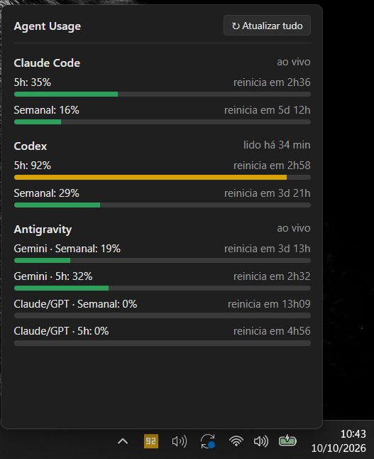

# Agent Usage

> Painel unificado para monitorar os limites de uso (janelas de 5h e semanal) de **Claude Code**, **Codex** e **Antigravity** na bandeja do Windows e na barra de status do VS Code.

<p align="center">
  
</p>

<p align="center">
  <a href="https://github.com/vnmartinez/VsCodeLLMAgentUsage/releases/latest"></a>
  <a href="https://github.com/vnmartinez/VsCodeLLMAgentUsage/releases/download/v0.1.0/Agent.Usage.Setup.0.1.0.exe"></a>
  <a href="https://github.com/vnmartinez/VsCodeLLMAgentUsage/releases/download/v0.1.0/agent-usage-0.1.0.vsix"></a>
</p>

---

## Recursos

- **Visão consolidada:** Acompanhe em tempo real o percentual consumido e a contagem regressiva para reinício da janela rápida (5 horas) e da janela semanal.
- **Suporte multi-agente:**
  - **Claude Code:** limite de 5h e semanal via credenciais locais do OAuth.
  - **Codex:** monitoramento via sessões locais.
  - **Antigravity:** quotas de Gemini e Claude/GPT via language server local.
- **Ícone dinâmico na bandeja do Windows:**
  - Exibe o percentual do agente com maior consumo no momento.
  - Mudança de cor dinâmica por faixa: normal (verde), aviso (amarelo) e crítico (vermelho).
  - Popup escuro, rápido e moderno com barras de progresso e botão **"↻ Atualizar tudo"**.
  - Suporte a iniciar junto com o Windows.
- **Extensão para VS Code:**
  - Exibe o resumo na barra de status (`CC 12/46  CX 58/41  AG 11/49`).
  - Tooltip rico com detalhes completos de cada modelo e quota ao passar o mouse.
  - Clique direto no item para atualizar na hora.
- **Segurança e Privacidade:**
  - Leitura estritamente local (sem envio de tokens ou dados para servidores externos).
  - Cache seguro compartilhado entre a bandeja e a extensão (`%APPDATA%\agent-usage\last.json`).

---

## Instalação

### 1. Aplicativo de Bandeja (Windows)

1. Baixe o instalador mais recente: **[Agent Usage Setup 0.1.0.exe](https://github.com/vnmartinez/VsCodeLLMAgentUsage/releases/download/v0.1.0/Agent.Usage.Setup.0.1.0.exe)**.
2. Execute o instalador (instalação com 1 clique).
3. O ícone aparecerá na área de notificação da barra de tarefas (ao lado do relógio ou no menu chevron `^`).
4. *(Opcional)* Clique com o botão direito no ícone e selecione **"Iniciar com o Windows"**.

> [!TIP]
> Se o ícone ficar no menu oculto (`^`), basta arrastá-lo para a barra de tarefas principal do Windows para mantê-lo sempre visível.

### 2. Extensão para VS Code

1. Baixe o pacote da extensão: **[agent-usage-0.1.0.vsix](https://github.com/vnmartinez/VsCodeLLMAgentUsage/releases/download/v0.1.0/agent-usage-0.1.0.vsix)**.
2. No VS Code, abra o menu de Extensões (`Ctrl+Shift+X`), clique nos três pontinhos (`...`) no canto superior e selecione **"Install from VSIX..."** (ou execute via terminal: `code --install-extension agent-usage-0.1.0.vsix`).

---

## Arquitetura do Projeto

Monorepo TypeScript gerenciado com npm workspaces:

```
VsCodeLLMAgentUsage/
├── assets/                  # Imagens e capturas de tela do README
├── packages/
│   ├── core/                # Coletor agnóstico, providers, parsing, cache e formatação
│   ├── tray/                # Aplicação de bandeja desktop (Electron + esbuild + NSIS)
│   └── vscode/              # Extensão leve para a barra de status do VS Code
```

---

## Desenvolvimento Local

### Pré-requisitos
- Node.js (v20+ recomendado)
- npm

### Comandos

```bash
# Instalar dependências
npm install

# Executar testes unitários
npm test

# Validação de tipos TypeScript
npm run typecheck

# Iniciar o app da bandeja em desenvolvimento
npm start -w packages/tray

# Gerar o instalador Windows NSIS
npm run dist -w packages/tray

# Empacotar a extensão VSCode (.vsix)
npm run package -w packages/vscode
```

---

## Licença

Distribuído sob a licença MIT. Veja `LICENSE` para mais informações.
